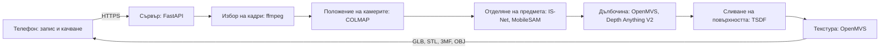

# Orbitize: от камерата на телефона до 3D модел за печат

Orbitize е мобилно приложение със собствен сървър, което превръща обикновено видео на предмет в 3D модел с реални
размери. Потребителят обикаля предмета с телефона, сървърът възстановява формата и цветовете му, а готовият модел
може да се разгледа, да се види в стаята с добавена реалност и да се изтегли за 3D печат.

Проектът е разработен за **Националната олимпиада по информационни технологии (НОИТ)**.

## Възможности

- **Заснемане с насоки:** подсказва темпото и височината на двата кръга около предмета и проверява дали е обиколен докрай.
- **Два начина на обработка:** стандартно сканиране по фотограметрия и по-бърз AI модел.
- **Реален размер:** потребителят въвежда най-дългата страна на предмета, а моделът се мащабира точно по нея.
- **Преглед и измерване:** въртене и мащабиране на модела, измерване директно върху него, цял екран.
- **Добавена реалност:** предметът се поставя в стаята в реалния си размер.
- **Изнасяне за печат:** файлове STL, 3MF, OBJ и GLB, с оценка за време и материал.
- **Промени с AI:** цвят, форма и табелка с име се променят чрез кратко текстово описание на английски.
- **Тест за здравина:** приблизително изчисление къде моделът би се счупил под натоварване.
- **Общност и споделяне:** публични страници на модели, видео със завъртане и линкове за споделяне.
- **Профили и напредък:** регистрация с имейл или Google, запазени сканирания, значки и седмични предизвикателства.

## Как работи



1. **Запис.** Приложението записва два бавни кръга около предмета и пази показанията на сензорите за положение.
   Видеото се качва на части, така че при прекъсната връзка качването продължава оттам, докъдето е стигнало.
2. **Подбор на кадри.** Сървърът оценява рязкостта и движението в кадрите и запазва най-рязкия кадър от всеки равен
   участък от движението на камерата.
3. **Камери.** COLMAP намира откъде е заснет всеки кадър. Ако предметът е без шарка и съвпаденията не стигат,
   положенията се изчисляват от сензорите на телефона.
4. **Отделяне на предмета.** IS-Net намира предмета във всеки кадър, а MobileSAM уточнява очертанията му с подсказки
   от вече изчислената 3D форма.
5. **Форма.** OpenMVS изчислява карти на дълбочината около предмета. Depth Anything V2 допълнително показва формата
   на тъмните, гладките и лъскавите части, където съвпаденията между кадрите са малко.
6. **Повърхност.** Всички кадри гласуват къде минава повърхността (усреднено пресечено разстояние със знак, TSDF).
   Така шумът намалява, а дупките се запълват от очертанията на предмета.
7. **Завършване.** Моделът се изравнява, масата се отрязва, отворите се затварят и снимките се нанасят като текстура.

Подробното описание на алгоритмите и архитектурата е в [описанието на проекта](docs/описание-на-проекта.md).

## Технологии

| Част | Средства |
|---|---|
| Мобилно приложение | Expo SDK 58, React Native, TypeScript, Expo Router, three.js |
| Сървър | Python, FastAPI, SQLAlchemy, SQLite или MySQL |
| 3D възстановяване | COLMAP, OpenMVS, PyMeshLab, trimesh |
| AI модели (на процесора, без видеокарта) | IS-Net, MobileSAM, Depth Anything V2, TripoSR, Qwen2.5, CLIPSeg |
| Публичен достъп | Tailscale Funnel или Docker под Linux |

## Структура на проекта

```text
src/app/          екрани на приложението (Expo Router)
src/components/   общи компоненти на интерфейса
src/lib/          логика на приложението и връзка със сървъра
modules/          родни модули на приложението (добавена реалност)
backend/app/      сървър и обработка на 3D модели
backend/scripts/  инсталиране и стартиране на сървъра
backend/tests/    автоматични тестове на сървъра
docs/             документация
```

## Документация

- [Потребителско ръководство](docs/потребителско-ръководство.md)
- [Описание на проекта](docs/описание-на-проекта.md)
- [Инсталиране на сървъра](docs/инсталиране-на-сървъра.md)
- [Използвани компоненти и лицензи](docs/лицензи.md)

## Инсталиране

### Сървър

За Windows Server 2025 или Windows 11, без WSL и Docker, следвайте
[ръководството за инсталиране](docs/инсталиране-на-сървъра.md).

За Linux с Docker:

```bash
cd backend
cp .env.example .env            # задайте дълга случайна стойност на API_TOKEN: openssl rand -hex 24
docker compose up --build -d    # първото изграждане компилира OpenMVS и отнема 20-40 минути
curl localhost:8000/health
```

### Приложение

Нужни са Node.js 22, npm и профил в Expo.

```bash
npm install
cp .env.example .env.local      # задайте адреса на сървъра в EXPO_PUBLIC_API_URL
npx eas-cli@latest build --profile preview --platform android
```

Командата изгражда файл APK в облака, който се инсталира на телефон с Android. Деинсталира се като всяко друго
приложение от настройките на телефона.

## Проверки

```bash
npm run typecheck && npm run lint && npm test    # приложение
cd backend && pytest -q                          # сървър
```

## Сигурност

- Приложението изпраща само сесийния ключ на влезлия потребител, а всеки потребител вижда само своите сканирания.
- Паролите се пазят като хешове със scrypt, а сесийните ключове също се пазят хеширани.
- Сървърът приема заявки само от 127.0.0.1, а отвън е достъпен само през HTTPS тунел.
- Тайните настройки стоят във файлове извън хранилището (вижте `.env.example` и `backend/.env.example`).

## Ограничения

- **Работи добре:** матови предмети с размер около 5-50 см, които се различават от масата, при равномерна светлина.
- **Излиза по-грубо:** едноцветни и тъмни предмети, защото формата им идва главно от очертанията.
- **Не работи:** лъскави и прозрачни предмети, предмети в цвета на масата, тънки части като жици и коса.
- **Размер:** видеото не носи абсолютен мащаб, затова реалната дължина се въвежда от потребителя.

## Лиценз

Проектът се разпространява под [GNU General Public License версия 3](LICENSE). Официалният текст на лиценза е на
английски език; наличен е и [неофициален превод на български](https://vanyog.com/index.php?pid=90). Лицензите на
използваните компоненти са описани в [отделен документ](docs/лицензи.md).
