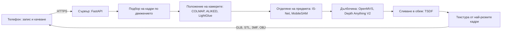

# Орбитайз (Orbitize): реален предмет -> 3D модел в реален размер, готов за 3D печат

Орбитайз е мобилно приложение (Android) с уебсайт и сървър, което превръща реален предмет в 3D модел с правилна форма
и в реален размер, готов за 3D печат. Нужен е само телефон.

Проектът е разработен за **Националния есенен турнир по информационни технологии „Джон Атанасов“ 2026/2027**,
направление „Софтуерни приложения“. Автор: Мирослав Тодоров, 10 клас, ПМГ „Атанас Радев“. Ръководител: Борислав Попов.

## Два режима

- **ИИ модел от видео** – за фигурки, играчки и органични форми. Потребителят обикаля предмета с телефона около
  минута, а сървърът за около 12 минути изгражда текстуриран, затворен модел.
- **Инженерен режим (CAD модел 1:1)** – за технически детайли. Снимките казват какво има (очертания, отвори,
  стъпала), а мерките с шублер – колко е голямо. Резултатът е параметричен CAD модел: STEP, STL, чертеж и кодът на
  модела.

Всичко се обработва локално на сървъра – без платени API ключове, външни ИИ услуги и абонаменти.

## Възможности

- **Заснемане с проверка:** живи числа за скорост, рязкост и светлина; кръговете светват за заснетите страни.
- **Преглед и измерване:** въртене и мащабиране на модела, измерване директно върху него, цял екран.
- **Изнасяне за печат:** STL, 3MF, OBJ, GLB, а от инженерния режим и STEP, с оценка за време и материал.
- **Тест за здравина:** метод на крайните елементи; напреженията се оцветяват от синьо до червено.
- **Табелка с име:** моделът застава върху поставка с надпис, готова за печат.
- **Общност и споделяне:** публични страници на модели, видео със завъртане и линкове за споделяне.
- **Профили:** регистрация с имейл и задължителен код по имейл, запазени модели, значки и седмични предизвикателства.
- **Администриране:** профили и статус, опашката на сървъра, сигнали в общността, поща – в приложението и в уебсайта.
- **Уебсайт:** папката `website/` (IIS) с вход, моделите в 3D, инженерния режим, общността и изтегляне на APK.

## Как работи

**ИИ модел от видео:**



1. **Запис.** Приложението записва видео и показанията на сензорите. Качването е на части и продължава след прекъсване.
2. **Подбор на кадри.** Кадрите се избират според движението на камерата, а не на равни интервали във времето.
3. **Камери.** COLMAP (с научени особености ALIKED и LightGlue) намира откъде е заснет всеки кадър.
4. **Предметът.** IS-Net и MobileSAM изрязват предмета, с подсказки от вече изчислената 3D форма.
5. **Форма.** Измерената дълбочина (OpenMVS) и ИИ дълбочината (Depth Anything V2) се сливат в един затворен обем
   (TSDF), а повърхността се извлича с марширащи кубове.
6. **Завършване.** Масата се отрязва, дупките се затварят, а цветът се взима от най-резките кадри.

Ако кадрите не могат да се разположат в 3D (много кратко или размазано видео), резервен модел се прави от най-добрия
кадър с TripoSR (локално).

**Инженерен режим:** Florence-2 разбира кое на снимката е детайлът, SAM 2.1 изрязва точното му очертание с отворите,
очертанието се опростява (Douglas–Peucker, с откриване на заоблени ъгли), приложението пита за мерките, а CadQuery
строи модела само от измерените числа.

Подробното описание е в [описанието на проекта](docs/описание-на-проекта.md).

## Технологии

| Част | Средства |
|---|---|
| Мобилно приложение | Expo SDK 58, React Native, TypeScript, Expo Router, three.js |
| Сървър | Python, FastAPI, SQLAlchemy, SQLite или MySQL |
| 3D възстановяване | COLMAP, OpenMVS, PyMeshLab, trimesh |
| ИИ модели (на процесора, без видеокарта) | IS-Net, MobileSAM, Depth Anything V2, MoGe-2, TripoSR, Florence-2, SAM 2.1 |
| Инженерен режим | CadQuery (OpenCascade), STEP |
| Публичен достъп | Tailscale Funnel или Docker под Linux |

## Структура на проекта

```text
src/app/          екрани на приложението (Expo Router)
src/components/   общи компоненти на интерфейса
src/lib/          логика на приложението и връзка със сървъра
backend/app/      сървър и обработка на 3D модели
backend/scripts/  инсталиране и стартиране на сървъра
backend/tests/    автоматични тестове на сървъра
website/          уебсайтът (статични файлове за IIS; backend/scripts/update-website.ps1 го обновява)
docs/             документация
```

## Документация

- [Потребителско ръководство](docs/потребителско-ръководство.md)
- [Описание на проекта](docs/описание-на-проекта.md)
- [Инсталиране на сървъра](docs/инсталиране-на-сървъра.md)
- [Използвани компоненти и лицензи](docs/лицензи.md)

## Инсталиране

### Сървър

За Windows Server 2025 или Windows 11, без WSL и Docker, следвайте
[ръководството за инсталиране](docs/инсталиране-на-сървъра.md).

За Linux с Docker:

```bash
cd backend
cp .env.example .env            # задайте дълга случайна стойност на API_TOKEN: openssl rand -hex 24
docker compose up --build -d    # първото изграждане компилира OpenMVS и отнема 20-40 минути
curl localhost:8000/health
```

### Приложение

Нужни са Node.js 22, npm и профил в Expo.

```bash
npm install
cp .env.example .env.local      # задайте адреса на сървъра в EXPO_PUBLIC_API_URL
npx eas-cli@latest build --profile preview --platform android
```

Командата изгражда файл APK в облака, който се инсталира на телефон с Android. Деинсталира се като всяко друго
приложение от настройките на телефона.

## Проверки

```bash
npm run typecheck && npm run lint && npm test    # приложение
cd backend && pytest -q                          # сървър
```

## Сигурност

- Приложението изпраща само сесийния ключ на влезлия потребител, а всеки потребител вижда само своите сканирания.
- Паролите се пазят като хешове със scrypt, а сесийните ключове също се пазят хеширани.
- Сървърът приема заявки само от 127.0.0.1, а отвън е достъпен само през HTTPS тунел.
- Тайните настройки стоят във файлове извън хранилището (вижте `.env.example` и `backend/.env.example`).

## Ограничения

- **Работи добре:** матови предмети с размер около 5-50 см, които се различават от масата, при равномерна светлина.
- **Излиза по-грубо:** едноцветни и тъмни предмети, защото формата им идва главно от очертанията.
- **Не работи:** лъскави и прозрачни предмети, предмети в цвета на масата, тънки части като жици и коса.
- **Размер:** видеото не носи абсолютен мащаб, затова при ИИ модела реалната дължина се въвежда от потребителя; в
  инженерния режим размерите идват от мерките.

## Лиценз

Проектът се разпространява под [GNU General Public License версия 3](LICENSE). Официалният текст на лиценза е на
английски език; наличен е и [неофициален превод на български](https://vanyog.com/index.php?pid=90). Лицензите на
използваните компоненти са описани в [отделен документ](docs/лицензи.md).
