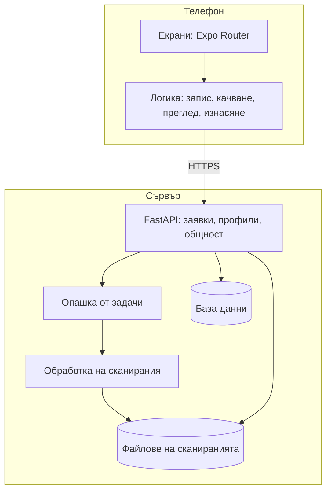

# Описание на проекта

Тема: **Orbitize: мобилно приложение за превръщане на видео в 3D модел за печат**

## Цели

Хората с 3D принтер често искат да копират, поправят или споделят реален предмет, но за целта са нужни или умения за
3D моделиране, или специален скенер. Съществуват приложения за 3D сканиране с телефон като Polycam и KIRI Engine, но
Orbitize е насочено конкретно към печата: модел в реален размер, затворена повърхност, готови файлове и оценка за
материал и време, изцяло на български език и със собствен сървър.

Основните цели са:

- сканиране с обикновен телефон, без специален хардуер и без видеокарта на сървъра;
- надеждно отделяне на предмета от фона, каквото и да има около него;
- модел, готов за 3D печат, с точни пропорции и реален размер;
- прост интерфейс, който не изисква технически познания.

## Основни етапи

1. Приложение с насочено заснемане и сървър за фотограметрия с COLMAP и OpenMVS.
2. Инсталиране на собствен сървър под Windows и публичен достъп по HTTPS.
3. Запис на видео вместо снимки, качване на части и автоматичен избор на кадри.
4. Отделяне на предмета с AI, обвивка от очертанията и дълбочина с AI за трудните предмети.
5. Сливане на картите на дълбочината в обща повърхност и текстура от снимките.
6. Профили, планове, общност, добавена реалност, тест за здравина и промени с AI.
7. Ускоряване на AI модела чрез паралелна обработка и измерване само около предмета.
8. Предмети, въртени в ръка, модел от една снимка и фини детайли от AI дълбочината; спиране на старото сканиране за около
   35 минути (Git етикет `standard-scan-35min`, променлива `CLASSIC_SCAN` на сървъра).
9. Насочване към инженери: режим „Точна част“ (снимки и мерки с линийка -> CAD модел 1:1); моделът от една снимка е махнат
   от приложението, а видеото остава за фигури и всичко останало.

## Сложност и основни проблеми

- **Предмети без шарка.** Съвпаденията между кадрите не стигат за изчисляване на камерите. Тогава AI моделът се прави
  от един кадър (TripoSR) като резервен вариант.
- **Отделяне от фона.** Една грешна маска може да добави стол или част от маса към модела. Затова кадрите се проверяват
  взаимно, а маските се правят наново с подсказки от вече изчислената 3D форма.
- **Шум в дълбочината.** Картите на OpenMVS са точни, но шумни и празни по тъмните части. Дълбочината от AI е гладка,
  но с неизвестен мащаб. Двете се съчетават, като AI дълбочината се напасва към измерената за всеки кадър.
- **Работа без видеокарта.** Обработката върви на процесор, затова моделите са в ONNX, а работата се разпределя между
  ядрата. На Windows OpenBLAS не позволява две едновременни матрични операции, затова паралелният код ги избягва.
- **Телефонът като клиент.** Моделите се показват и изнасят с JavaScript, затова размерът им е ограничен до 250 000
  триъгълника, а текстурата се декодира директно към видеокартата на телефона.

## Логическо и функционално описание

### Модули на приложението

| Модул | Предназначение |
|---|---|
| `src/app/capture.tsx` | запис с насоки за темпо и височина, следене на обиколката |
| `src/app/processing/` | качване и следене на обработката |
| `src/app/viewer/` | преглед, измерване, промени, изнасяне и споделяне |
| `src/app/stress/` | показване на резултата от теста за здравина |
| `src/app/community/`, `src/app/(tabs)/` | общност, сканирания, профил и начален екран |
| `src/lib/api.ts` | връзка със сървъра |
| `modules/scene-viewer/` | роден модул за добавена реалност |

### Модули на сървъра

| Модул | Предназначение |
|---|---|
| `main.py`, `jobs.py` | заявки, качване и опашка от задачи |
| `accounts.py`, `db.py`, `plans.py` | профили, база данни и ограничения по план |
| `community.py`, `progress.py`, `notify.py`, `billing.py` | общност, значки, известия и плащания |
| `video.py` | избор на кадри от видео |
| `pipeline.py` | кадри, камери и старото сканиране (спряно за потребителите) |
| `ai.py`, `outline.py` | AI модел от видео |
| `relief.py` | фините детайли от AI дълбочината |
| `single3d.py`, `photo3d.py` | модел от една снимка (вече не се предлага в приложението) |
| `cadfit.py` | „Точна част“ и чист CAD модел: проект от Gemini, сверен със сканирането, в размера по мерките |
| `segment.py`, `refine.py` | маски на предмета с IS-Net и MobileSAM |
| `depth.py`, `motion.py` | дълбочина с AI и положения от сензорите |
| `fuse.py`, `mesh.py`, `texture.py` | повърхност, почистване и текстура |
| `edit.py`, `edit_llm.py`, `recolor.py` | промени с AI |
| `stress.py`, `printing.py`, `ar.py`, `render.py` | здравина, печат, добавена реалност и видео |
| `parallel.py` | паралелна обработка, безопасна за Windows |

## Реализация

**Expo и React Native** позволяват едно приложение с TypeScript и бързи обновявания. **FastAPI** дава ясни и проверени
заявки, а обработката върви в отделни процеси, така че грешка в тежка стъпка не спира сървъра.

Кадрите преминават през следните алгоритми:

1. **Подбор на кадри.** Видеото се разделя на равни участъци по движението на камерата и от всеки се взема най-рязкият
   кадър. Така стоенето на едно място и неравното темпо не хабят кадри.
2. **Структура от движение (COLMAP).** Намират се положенията на камерите, а резултатите от два решаващи алгоритъма се
   сравняват по това колко кадъра сочат към обща точка. Когато фонът остава същият през видеото (корелация на финия му
   детайл след изместване), предметът се е въртял пред неподвижен телефон и особеностите се търсят само върху него.
3. **Маски.** IS-Net дава първите маски. Следва обвивка от очертанията (обемът вътре в очертанията на повечето кадри), а
   MobileSAM получава от нея точки „предмет“ и „не е предмет“ за всеки кадър.
4. **Гъсти съвпадения (OpenMVS).** Картите на дълбочината се изчисляват само в област около предмета, което намалява
   обработваните пиксели.
5. **AI дълбочина (Depth Anything V2).** За всеки кадър мащабът и отместването се напасват устойчиво към измерените точки,
   след което гладко корекционно поле поправя огъването.
6. **Сливане (TSDF).** Във воксели със страна около 1/400 от размера на предмета всеки кадър гласува за разстоянието до
   повърхността. Гласовете, които силно се разминават с останалите, отпадат при втори проход.
7. **Почистване.** Моделът се завърта спрямо стъпката си, отрязва се масата, дупките се затварят и лошите ръбове се
   поправят.
8. **Фини детайли.** На целия кадър обхватът на AI дълбочината отива за разликата между предмета и стаята и повърхността му
   остава равна. Затова мрежата получава само предмета, с фон, запълнен с цветовете му, и с повече пиксели. Издадените части
   излизат ясно, а надписите остават плоски. Тази дълбочина няма мащаб: от нея се взема само тясна лента, с разлика около 1%
   от размера на модела, осреднена от кадри, избрани да покриват всяка страна, и се нанася по нормалите на повърхността.
9. **Текстура (OpenMVS TextureMesh).** Снимките се нанасят върху повърхността, така че надписите върху предмета да се четат.

Моделът от една снимка е два слоя над пикселите на снимката, отпред и отзад, зашити по очертанието в затворена мрежа.
TripoSR дава голямата форма и задната страна, а снимката дава очертанието, текстурата отпред и (чрез AI дълбочината)
релефа. Когато кадрите са от видео, гърба дава друг кадър със същата дължина и пропорции на предмета, с огледално същото
очертание и без общи особености с лицето. Плосък предмет (дистанционно, телефон) получава истинското си напречно сечение от
кадрите, в които е обърнат с края към камерата, а дебелината по дължината (скосени и заоблени краища) от кадрите отстрани; кое
лице е заобленото, показват посоките на повърхността от MoGe-2. Пръсти, които закриват лицето само в избрания кадър, се
заменят с медианата на другите изгледи от същата страна, а оттенъкът на светлината в стаята се маха от бели, сиви и черни
предмети. При една снимка CLIP първо разпознава какъв е предметът: плоският (дистанционно, телефон, книга) получава
обичайната за вида дебелина, кръглият (чаша, бутилка, ваза) се завърта около оста си, а всичко друго идва от формата на TripoSR.
Името му става заглавие на модела.

„Точна част“ е за дребни инженерни части (клипс, държач, капачка). Потребителят снима частта от всички страни и въвежда
мерките ѝ с линийка. С поне 10 снимки сървърът първо я сканира като AI модела. След това безплатният Gemini (Google)
я проектира от прости тела (кутии, цилиндри, очертания, завъртени профили, отвори), а сървърът изгражда проекта, сравнява го
със сканирането от шест страни (очертания и дълбочина) и връща на Gemini картина къде се различават, докато съвпаднат. Накрая
моделът се мащабира точно по мерките на потребителя, така че отпечатаното копие е 1:1. Така се прави и „ръчното“ копиране с
ChatGPT по снимки и мерки, но поправките идват от истинската форма, а не от човек.

Резервни пътища пазят резултата: при неуспешно сливане повърхността се изгражда от точките с екранирана реконструкция на
Поасон, а ако камерите не могат да се изчислят от кадрите, се използват сензорите на телефона.

Сигурността включва сесийни ключове, хеширани пароли (scrypt), ограничения за размер и брой задачи, проверка на
собственика при всяка заявка и подписани временни линкове за добавената реалност.

Използваните компоненти са описани в [отделен документ](лицензи.md).

## Описание на приложението

Инсталирането и употребата са описани в [потребителското ръководство](потребителско-ръководство.md), а инсталирането и
поддръжката на сървъра в [отделно ръководство](инсталиране-на-сървъра.md). Автоматичните тестове се стартират с
`npm test` за приложението и `pytest` за сървъра.

## Заключение

Резултатът е работещо приложение, което от обикновено видео създава 3D модел в реален размер, готов за печат, на сървър
без видеокарта.

Възможности за развитие:

- издаване в Google Play и версия за iOS;
- по-бърза обработка с видеокарта;
- по-добра работа с лъскави и прозрачни предмети;
- промени с AI, които приемат описание на български език.
